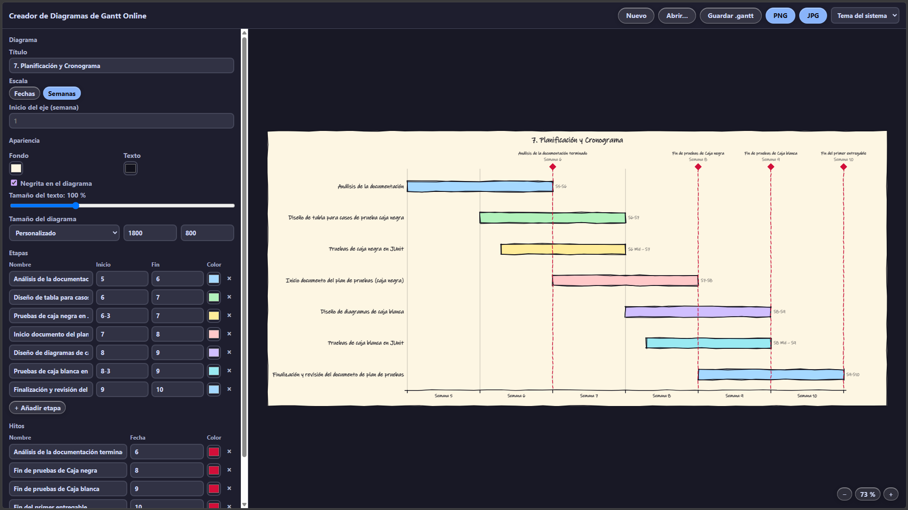

# Creador de Diagramas de Gantt Online

1. Pon un **título** y elige la escala: **Fechas** o **Semanas**.
2. Añade **etapas** (Nombre, Inicio, Fin, Color) y **hitos** (Nombre, Fecha, Color).
3. El diagrama dibujado a mano se actualiza al instante a la derecha.
4. Cambia fondo, texto y tamaño en **Apariencia**.
5. **Guardar .gantt** para seguir luego con **Abrir…**, o exporta en **PNG** o **JPG**.

Web: abre `web/index.html`. Escritorio: `python diagrama.py` (requiere pillow).
